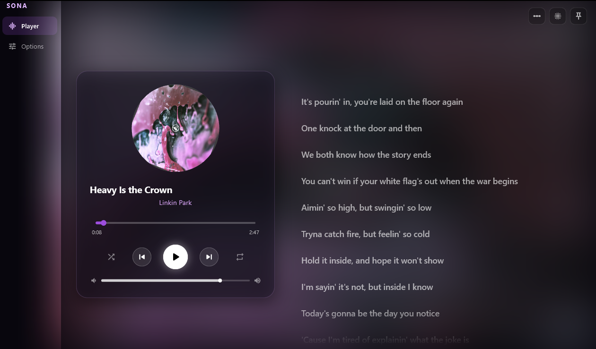

<div align="center">



# SONA

**A vinyl-style now-playing card for whatever Windows is playing.**

Spotify, YouTube in the browser, Apple Music, VLC: one interface that shows the track,
follows the synced lyrics and controls playback, without switching windows.

[](https://github.com/Carmine0033/Sona/releases/latest)
[](LICENSE)

[](https://flutter.dev)

[**Download for Windows**](https://github.com/Carmine0033/Sona/releases/latest)

</div>

<!-- Screenshot: add image/screenshot.png and uncomment.
<p align="center"></p>
-->

---

## What it does

Sona reads the Windows media controls (SMTC), the same ones behind the volume flyout. Any app
that shows up there works with Sona, with no plugins, logins or per-app setup.

### Now playing
- **Vinyl card** with a spinning disc (classic vinyl or album cover) and a record-change animation when the track changes.
- **Controls:** play/pause, next, previous and seeking from the progress bar (line or animated wave).
- **Synced lyrics** from [LRCLIB](https://lrclib.net). Click a line to jump to it, or open them full size.
- **Per-app volume** for Spotify.

### Mini player
- Detach the card into its own **frameless, resizable, always-on-top** window, over a game, a stream or your work.
- Reattach it to the main window with one click.

### Make it yours
- Accent color (curated palette or any hex value)
- Glass or opaque background
- Your own image or GIF on the disc
- Disc style and progress bar style

### Playlists and built-in player
- Paste the link of a **public playlist** from Spotify, YouTube / YouTube Music, Apple Music or Deezer. No account needed.
- **Library** with favorites, filters by source and one-click sync.
- **Track table** you can sort, with search inside a playlist or across all of them (`Ctrl+F`).
- **Built-in player** with shuffle, repeat, volume and a floating player bar. You can give the bar a blurred cover or a custom image/GIF.
- **Discord Rich Presence** (opt-in).

> The built-in player is Sona's own playback, not a remote for another app. Playlists only provide
> the track list: Sona looks for each track on YouTube and streams that audio. Sometimes it picks the wrong version.

### Everything else
- Automatic updates from GitHub Releases, with a "what's new" panel after each update
- English and Italian
- A single instance: opening Sona again brings the existing window to the front

---

## Install

1. Download `Sona-<version>-windows-setup.exe` from the [latest release](https://github.com/Carmine0033/Sona/releases/latest).
2. Run it. The installer isn't code-signed yet, so Windows SmartScreen may warn you. Click **More info → Run anyway**.
3. Start playing music in any app, then open Sona.

Sona checks for new versions on start and shows a banner to update in one click. You can also check manually from **Settings → About**.

## Privacy

Sona has no accounts, no telemetry and no ads. It goes online only for what you use:

| Feature | Service |
| --- | --- |
| Synced lyrics | lrclib.net |
| Updates | GitHub API |
| Playlist import | Spotify, YouTube, Apple Music, Deezer public pages/APIs |
| Built-in player | YouTube |
| Rich Presence | Discord client running locally (opt-in) |

Settings and your playlist library stay on your PC.

---

## Build from source

**Requirements:** Windows 10/11, the [Flutter SDK](https://docs.flutter.dev/get-started/install) (3.47 or later, Dart 3.13+), and Visual Studio with the *Desktop development with C++* workload.

```bash
git clone https://github.com/Carmine0033/Sona.git
cd Sona
flutter pub get
flutter run -d windows
```

**Optional build flags:**

| Flag | Effect |
| --- | --- |
| `--dart-define=YT_API_KEY=...` | Reads YouTube playlists through the official Data API instead of youtube.com's web API |
| `--dart-define=DISCORD_CLIENT_ID=...` | Uses your own Discord application for Rich Presence |

**Release builds:** `.\release.ps1 -Version x.y.z` bumps the version, updates `CHANGELOG.md` and the in-app release notes, then builds the app and the [Inno Setup](https://jrsoftware.org/isinfo.php) installer.

### Tech stack
- [Flutter](https://flutter.dev) for Windows desktop, with [Riverpod](https://riverpod.dev) for state
- Native Win32 through `win32` and `ffi` (SMTC, per-app volume, single instance)
- `window_manager` for the frameless mini player
- `media_kit` for built-in playback

---

## Contributing

Bug reports, ideas and pull requests are welcome. Open an [issue](https://github.com/Carmine0033/Sona/issues) first for larger changes.

1. Fork the repository and create a branch (`git checkout -b feature/my-feature`)
2. Commit your changes
3. Open a pull request

## License

[MIT](LICENSE) © 2026 Carmine Iannone. Bundled fonts (Inter, JetBrains Mono, Space Grotesk) are under the [SIL Open Font License 1.1](assets/fonts/README.md).
